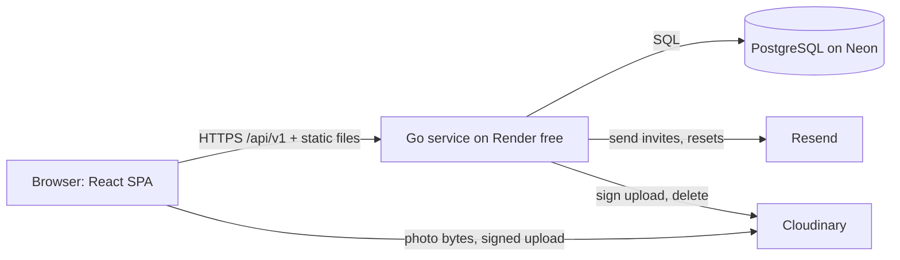
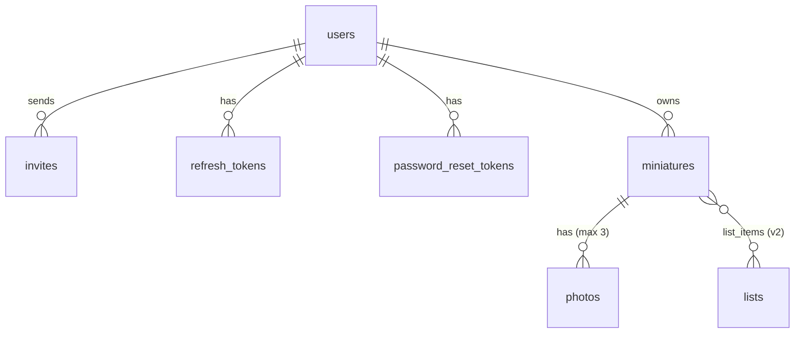

# Mini Manager: Planning Document

Oct 9, 2026 · @Mateus

## Summary

Mini Manager is an invite-only web app where about 10 players share one catalog of 300+ miniatures. Each mini belongs to the person who owns it physically, and everyone can filter the whole catalog to find minis for a session. The recommended stack is a React SPA and a Go REST API, deployed as one service, with PostgreSQL and Cloudinary for photos, all on free tiers. Go is the one new thing you learn. You already know React and SQL, so the MVP doesn't depend on learning three things at once. The MVP is done when an invited user can log in, create a mini with a photo, and find it again with filters.

## Assumptions

1. You (Mateus) are the only Admin at launch. Every other player is a Member who edits only their own minis (decided on the approval card).
2. Each MVP mini has D&D 5e fields only. Pathfinder 2e and other systems go into a spare JSON field later.
3. Faction, weapon and armor are tags such as `faction:drow` in the MVP, not separate fields.
4. Users never exceed about 20 and minis never exceed about 5,000, so one small server and one small database are enough.
5. There is no hard deadline. You build in your free time, so the plan cuts scope rather than working to a date.
6. Free-tier limits (database size, image credits, emails per day) are from memory and approximate. Check each one when you sign up, because providers change them.
7. The UI is in English. Translation can be added later because labels live in one place.

## 1. Main features

Seven features are planned: four for the MVP and three for later.

| Feature | One-line description | Priority |
| --- | --- | --- |
| User accounts | Admin invites people by email; users log in, log out, reset passwords, edit their profile; Admin and Member roles | MVP |
| Miniature catalog | Add, edit, delete, list and view details of minis in the shared collection | MVP |
| Search and filters | Narrow the list by name, type, size, CR, owner, paint status, tags and quantity, with the filters saved in the URL | MVP |
| Photos per miniature | Up to 3 photos per mini, with a cover thumbnail in the list | MVP (built last; first to slip) |
| Encounter picker | "I need 4 medium goblinoids" returns minis that cover it, or the shortfall | Later (v2) |
| Import / export CSV | Bulk import with a dry run; export the filtered list | Later (v1.1) |
| Private lists with a shareable link | Named session lists, private by default, read-only link to share | Later (v2) |

### Filters

| Filter | MVP | Notes |
| --- | --- | --- |
| Free-text name search | yes | Case- and accent-insensitive, matches any part of the name |
| Creature type | yes | The 14 D&D 5e types |
| Size (Tiny to Gargantuan) | yes | Multi-select |
| CR range | yes | Min and max; minis without CR are excluded only when this is set |
| Owner | yes | Needed because the collection is shared |
| Paint status | yes | Pre-painted, hand-painted, unpainted |
| Tags | yes | Match any or match all; covers faction, weapon and armor for now |
| Storage location | v1.1 | Free text in the MVP, becomes a filter once values settle |
| Manufacturer | v1.1 | Same as storage location; it is the worked example in section 6 |
| Faction, weapon / armor as fields | v1.1 | Promoted from tags into custom fields if tags get messy |

**AND / OR:** different filters combine with AND, and values inside one filter combine with OR. A nested rule builder ("(A or B) and not C") waits for v1.1.

**Saved filter presets:** v1.1. They store the URL query string, so they cost almost nothing once filters live in the URL.

## 2. MVP requirements

### Functional

1. An Admin invites a user by email; the user signs up from the invite link (Card 1).
2. Log in, log out and reset a forgotten password (Card 2).
3. Edit my display name and password (Card 3).
4. Create, edit, delete a miniature, see the list and see one mini's details (Card 5).
5. Members change only their own minis; the Admin changes any (Card 4).
6. Filter and search the list, with filters in the URL (Card 6).
7. Add up to 3 photos per mini (Card 7).

### Non-functional

| Area | Requirement | How it is checked |
| --- | --- | --- |
| Performance | List with filters responds in under 500 ms once the server is warm; the first request after idle can take up to a minute on Render's free tier | Manual timing in the browser network tab |
| Usability | Every screen works on a 375 px wide phone; filters open in a bottom sheet; photo upload uses the camera | Test on your own phone before calling MVP done |
| Authentication | Email + password now, Google later; JWT access token 15 min + rotating refresh cookie 7 days | Card 2 acceptance tests |
| Roles | Admin edits all and invites; Member views all, edits own | Card 4 acceptance tests, run against the API not just the UI |
| Sign-up | Invite only | No public sign-up route exists |
| Password reset | Yes, by email link valid 1 hour | Card 2 |
| Security | Hashed passwords (argon2id), HTTPS only, same-origin cookies, server-side permission checks, rate-limited login | Checklist in the first ADR |
| Backup | Later. Meanwhile the database provider's built-in point-in-time restore is the safety net | Confirm it exists on the chosen free plan |

### Out of the MVP

Session lists and shareable links, Google login, CSV import and export, the encounter picker, saved presets, custom fields, and storage location and manufacturer as filters.

### Definition of done

The MVP is done when an invited Member logs in on their phone, creates a mini with a photo, and finds it with at least two filters combined. The Admin also needs to see that mini and be able to edit it, and another Member must not be able to edit it.

## 3. Architecture

The recommendation is a single Go service that serves both the REST API and the built React SPA from one URL. It uses PostgreSQL for data and Cloudinary for images. Serving everything from one origin removes CORS problems, lets the refresh cookie be `SameSite=Strict`, and keeps hosting to one free service.

### Choices

| Layer | Recommended | Alternative considered | Why the recommendation wins |
| --- | --- | --- | --- |
| App style | SPA + REST API (`/api/v1`) | Next.js full-stack | You asked for SPA + REST, and a REST API is what a Go backend naturally exposes. The app needs no SEO because it's behind a login. |
| Frontend | React + Vite + TypeScript, React Router, TanStack Query, React Hook Form + Zod, Tailwind CSS v4 with the design system's tokens as its theme | Next.js | You know React. Vite builds static files that Go can serve, and Next's server features would sit unused next to a Go API. |
| Backend | Go 1.26 with `net/http` routing, `pgx` driver, `sqlc` for fixed queries, `squirrel` for the filter query | NestJS, which you know; C# ASP.NET Core | You wanted to learn a lower-level language, and Go is the smallest one: one binary and fast cold starts on free hosting. NestJS would get you to the MVP fastest, so switch to it if Go stalls you for more than a few weeks. C# is excellent but heavier to learn and to host. |
| Auth | Own implementation: JWT access token (15 min, kept in memory) + opaque refresh token (7 days, httpOnly cookie, stored hashed, rotated) | Hosted auth (Supabase Auth, Clerk) | Invite-only sign-up, roles and "last admin" rules are simple enough to build, and building them is good learning. Hosted auth saves about a week but splits users across two systems. |
| Image storage | Cloudinary free plan, signed direct upload from the browser | Cloudflare R2 (S3-compatible, generous free storage) | Cloudinary resizes, strips EXIF and fixes rotation for you (Card 7 rules 2 and 4). With R2 you would write that image pipeline yourself. |
| Database | PostgreSQL on Neon free plan | MongoDB Atlas free | See section 4. |
| Hosting | Render free web service (Docker, no card needed) | Google Cloud Run | You asked for a fully free option with no card, and Render, Neon, Cloudinary and Resend all sign up without one. The cost is a cold start: Render's free service sleeps after about 15 idle minutes and takes up to a minute to wake. A free uptime ping (UptimeRobot every 10 minutes) keeps it awake on game nights. Cloud Run wakes in about a second but needs a card on file. |
| Email | Resend free plan (invites, password reset) | Gmail SMTP | Resend has a proper API and deliverability, and its free plan is far above what 10 users need. |
| CI / deploy | GitHub Actions: test, build container, deploy to Render on push to `main` | Manual deploys | It's free for a personal repo and makes every deploy repeatable. |

### Component diagram



The browser talks only to the Go service, except for photo bytes. Those go straight to Cloudinary with a signature the API issues, so large uploads never pass through the free-tier server.

### Folder structure

The code is grouped by feature: one folder per Feature card, holding its handler, service, queries and tests.

```text
mini-manager/
  api/                        Go module
    cmd/server/main.go        wires config, db, routes; serves web/dist
    cmd/seed/main.go          creates the first Admin
    internal/
      platform/               shared plumbing, no business rules
        config/  db/  httpx/  auth/  email/  images/  flags/
      features/
        auth/                 Card 2, and changing a password (Card 3): handler.go service.go queries.sql service_test.go
        invites/              Card 1
        users/                Cards 3 and 4 (profile, roles, policy.go)
        members/              Card 4's Members page: joins users (roles) and auth (ending Sessions)
        miniatures/           Card 5
        filters/              Card 6: registry.go + one file per filter
          name.go  creature_type.go  size.go  cr.go  owner.go  paint.go  tags.go  quantity.go
        photos/               Card 7
    migrations/               00001_users_and_sessions.sql, 00002_...sql (goose)
    sqlc.yaml
  web/                        React + Vite
    src/
      app/                    router, providers, layout
      features/
        auth/  invites/  profile/  members/  miniatures/  filters/  photos/
          pages/  components/  api/  lib/   (each feature, split by kind; see docs/context.md)
      shared/                 api client, UI kit, form helpers
  docs/
    adr/                      0001-go-backend.md, 0002-postgres.md ...
    features/                 one approved Feature card per file
  Dockerfile                  builds web, then api, copies web/dist into the image
  .github/workflows/ci.yml
```

### Libraries

Go removes a library from `go.mod` when no code imports it, so each Go library is added in the build step that first uses it. Cloudinary and Resend are called with plain `net/http` (no SDKs), inside `platform/images` and `platform/email`. Tool versions and the frontend toolchain are in ADR 0001.

| Go library | Purpose | Added in build step |
| --- | --- | --- |
| `github.com/jackc/pgx/v5` | Postgres driver and pool | 1 |
| `github.com/pressly/goose/v3` | Check for pending migrations at startup; apply them in tests and `make migrate` | 1 |
| `golang.org/x/crypto` (argon2) | Password hashing | 1 |
| `github.com/golang-jwt/jwt/v5` | Access tokens | 1 |
| `github.com/google/uuid` | uuid v7 ids | 1 |
| `github.com/testcontainers/testcontainers-go` + `modules/postgres` | Service tests against real Postgres | 1 |
| `golang.org/x/text` (unicode/norm) | Removes accents for `name_search` | 2 |
| `github.com/Masterminds/squirrel` | Filter query builder | 3 |

Go tools pinned with `go get -tool` and run as `go tool <name>`: `sqlc`, `goose`, `staticcheck`, `air`.

### API style

The API is REST and JSON under `/api/v1`. Errors use the RFC 9457 `application/problem+json` format with a field-level `errors` list. List endpoints return `{ items, total, page, pageSize }`. Updates send the mini's `version` and get `409` on a conflict (Card 5 rule 7).

| Method | Path | Who | Purpose (card) |
| --- | --- | --- | --- |
| POST | /auth/login | anyone | Log in, returns access token, sets refresh cookie (2) |
| POST | /auth/refresh | cookie | Rotate refresh token, new access token (2) |
| POST | /auth/logout | user | Revoke refresh token (2) |
| POST | /auth/password-reset | anyone | Request reset email (2) |
| POST | /auth/password-reset/confirm | token | Set new password (2) |
| GET | /invites/{token} | anyone | Check an invite is valid, show its email (1) |
| POST | /invites/{token}/accept | anyone | Create account from invite (1) |
| GET, POST | /admin/invites | admin | List and send invites (1) |
| POST | /admin/invites/{id}/resend | admin | Resend, invalidating the old token (1) |
| DELETE | /admin/invites/{id} | admin | Cancel an invite (1) |
| GET | /admin/users | admin | Members page (4) |
| PATCH | /admin/users/{id} | admin | Change role or deactivate (4) |
| GET, PATCH | /me | user | Read and edit my profile (3) |
| POST | /auth/password | user | Change password (3); under /auth so the refresh cookie says which Session to keep |
| GET | /miniatures | user | List with filters, sort, paging (5, 6); the envelope adds `catalogTotal`, the unfiltered count, for "48 of 312 minis" |
| POST | /miniatures | user | Create (5) |
| GET | /miniatures/{id} | user | Details (5) |
| PUT | /miniatures/{id} | owner, admin | Update with version check (5) |
| DELETE | /miniatures/{id} | owner, admin | Delete with its photos (5) |
| POST | /miniatures/{id}/photos/signature | owner, admin | Get a signed Cloudinary upload (7) |
| POST | /miniatures/{id}/photos | owner, admin | Register an uploaded photo (7) |
| PATCH | /miniatures/{id}/photos/{photoId} | owner, admin | Make it the cover (7); no reordering (clarified 2026-10-12) |
| DELETE | /miniatures/{id}/photos/{photoId} | owner, admin | Remove a photo (7) |
| GET | /filters | user | Filter definitions from the registry, with whole-Catalog option counts, so the UI draws controls automatically (6) |
| GET | /tags | user | Tags in use, for the tag picker (6) |
| GET | /users/options | user | Active users for the owner filter (6) |
| GET | /flags | user | Feature flags for the current user (section 6) |

## 4. Database

Use PostgreSQL, not MongoDB. Your data is relational: minis belong to users, photos to minis, invites and tokens to users, and later lists hold minis. Postgres `JSONB` columns already give you schemaless flexibility where you need it (game-system stats, custom fields). Learning Mongo is a fair goal, but doing it together with Go means two new things on the critical path. Learn Mongo on a side project once the MVP ships.

### Postgres vs MongoDB for this app

| Question | PostgreSQL | MongoDB |
| --- | --- | --- |
| Fits the data? | Yes: users, ownership, photos, lists are foreign keys | Partly: photos fit as embedded docs; ownership and lists need manual references |
| Flexible attributes per system | `JSONB` column + GIN index | Native, the main strength |
| Integrity ("last admin", cascade photo delete, unique invite) | Constraints and transactions built in | Must be enforced in code |
| Filters (AND across fields, OR inside one, tag any/all, substring search) | Plain SQL, `text[]` operators, `pg_trgm` | Query operators work well too |
| What you already know | SQL, very familiar | New |
| Free tier | Neon free (about 0.5 GB, scales to zero) | Atlas M0 (about 512 MB) |
| Go tooling | `pgx` + `sqlc` generate type-safe code from SQL | Official driver, more hand-written mapping |

### Entity-relationship diagram



In the diagram, lists and list\_items are v2 only. They make miniatures many-to-many with lists in v2; lists also belong to a user (not drawn). feature\_flags stands alone with no relations.

### Tables

Every `id` is a `uuid` (v7, time-ordered). Every table has `created_at timestamptz` and the mutable ones have `updated_at timestamptz`, both set by the server.

**users**

| Field | Type | Notes |
| --- | --- | --- |
| id | uuid PK |  |
| email | citext UNIQUE | case-insensitive |
| password\_hash | text | argon2id |
| display\_name | varchar(40) |  |
| role | enum `user_role` (admin, member) |  |
| active | boolean default true |  |

The lockout (Card 2 rule 3) is not stored on `users`; see **login\_failures** below and ADR 0002.

**invites**

| Field | Type | Notes |
| --- | --- | --- |
| id | uuid PK |  |
| email | citext |  |
| role | user\_role |  |
| token\_hash | text UNIQUE | only the hash is stored |
| invited\_by | uuid FK users |  |
| expires\_at | timestamptz | now + 7 days |
| accepted\_at, cancelled\_at | timestamptz null |  |

**refresh\_tokens** and **password\_reset\_tokens**

| Field | Type | Notes |
| --- | --- | --- |
| id | uuid PK |  |
| user\_id | uuid FK users ON DELETE CASCADE |  |
| token\_hash | text UNIQUE |  |
| expires\_at | timestamptz | 7 days or 1 hour |
| revoked\_at / used\_at | timestamptz null |  |
| replaced\_by | uuid null (refresh only) | detects reuse of a rotated token |
| session\_id | uuid (refresh only) | groups every token of one Session, so reuse revokes the whole Session (ADR 0002) |

**login\_failures**

| Field | Type | Notes |
| --- | --- | --- |
| id | uuid PK |  |
| email | citext | no FK: unknown emails are recorded too, so the lockout reveals nothing (Card 2 rules 2 and 3) |
| failed\_at | timestamptz | index (email, failed\_at) |

**miniatures**

| Field | Type | Notes |
| --- | --- | --- |
| id | uuid PK |  |
| owner\_id | uuid FK users | indexed |
| name | varchar(100) |  |
| name\_search | text | lower-cased, accents removed; written by the service on every save |
| creature\_type | enum `creature_type` (14 values) |  |
| size | enum `creature_size` (tiny to gargantuan) | enum order = size order, so sorting works |
| challenge\_rating | numeric(5,3) null | CHECK value in the 5e CR list |
| quantity | smallint | CHECK 1 to 999 |
| paint\_status | enum `paint_status` | pre\_painted, hand\_painted, unpainted |
| tags | text\[\] default '{}' | CHECK cardinality ≤ 20 |
| storage\_location | varchar(60) null |  |
| manufacturer | varchar(60) null |  |
| notes | varchar(1000) null |  |
| system\_stats | jsonb default '{}' | per game system, see below |
| custom\_fields | jsonb default '{}' | v1.1, section 6 |
| version | integer default 1 | optimistic locking |
| created\_by | uuid FK users |  |

**photos**

| Field | Type | Notes |
| --- | --- | --- |
| id | uuid PK |  |
| miniature\_id | uuid FK miniatures ON DELETE CASCADE |  |
| provider\_id | text | Cloudinary public id, used to delete the file |
| width, height, bytes | integer |  |
| position | smallint | 0 to 2 |
| is\_cover | boolean | partial UNIQUE (miniature\_id) WHERE is\_cover |

**feature\_flags**

| Field | Type | Notes |
| --- | --- | --- |
| key | text PK | e.g. `photos`, `csv_import` |
| enabled | boolean |  |
| roles | user\_role\[\] null | null = everyone; otherwise only these roles |
| description | text |  |

Later tables: `lists`, `list_items` (lists ↔ miniatures, many-to-many with a count), `saved_filters`, `custom_field_definitions`.

### Relations

- users 1 → many miniatures (owner\_id), 1 → many invites (invited\_by), 1 → many refresh and reset tokens.
- miniatures 1 → many photos (0 to 3, enforced in the service inside a transaction).
- Later: lists many ↔ many miniatures through list\_items.
- Tags are a `text[]` column, not a Tag table. With hundreds of minis this is simpler, and the GIN index serves both "any" (`&&`) and "all" (`@>`). Move to a Tag table only if tags need their own data such as colour or description.

### Indexes for the filters

| Index | Serves |
| --- | --- |
| btree (owner\_id) | owner filter, "my minis" |
| btree (creature\_type), btree (size), btree (paint\_status) | multi-select filters |
| btree (challenge\_rating) | CR range and sort |
| GIN (tags) | tags any / all |
| GIN (name\_search gin\_trgm\_ops) | substring name search (`pg_trgm`) |
| btree (name\_search, id) | default sort and stable paging |
| btree (created\_at) | "newest" sort |
| GIN (system\_stats jsonb\_path\_ops) | added later, when a system filter exists |

To be honest about scale: at 300 to 5,000 rows Postgres scans the whole table in about a millisecond, so these indexes are not needed for speed yet. Create them in the miniatures migration anyway. They cost nothing at this size, and you get to learn them with `EXPLAIN`.

### System-specific attributes without a schema change

`system_stats` is a JSONB object keyed by system, validated in the service against a small schema per system:

```json
{ "pf2e": { "level": 3, "traits": ["goblin", "humanoid"] } }
```

Adding Pathfinder 2e then means a validator file and a filter registry entry that queries `system_stats->'pf2e'->>'level'`, with no migration. D&D 5e stays in real columns because it is the main system and the most filtered. The group does not need Pathfinder 2e, so no validator is planned: the column stays empty and costs nothing until another system is wanted.

### Migration strategy

1. Use `goose` with plain SQL files in `api/migrations`, numbered and committed with the code that needs them. Each build step adds its own migration (00001 is Users and Sessions; miniatures come in step 2).
2. CI runs every migration against a throwaway Postgres container before the tests.
3. Nothing applies migrations automatically (ADR 0002). Mateus reviews each migration and runs `make migrate` himself, against Neon before merging the PR that contains it. The server and the seed refuse to start while migrations are pending, so Render keeps the previous version live.
4. Never edit a migration that has already run. Fix forward with a new one.
5. Renames and type changes use expand and contract: add the new column, write both, backfill, switch reads, then drop the old one in a later migration.
6. Before a risky migration, create a Neon branch (a copy of production) and run it there first.
7. `cmd/seed` creates the first Admin from environment variables; it is idempotent.

## 5. Business logic

You approved all ten Feature cards. They stay in full, in the Feature card format, in Mini Manager: Feature Cards for Approval, so they are not copied here. Keep one source of truth, and copy each card into `docs/features/` when you start building it.

| Card | Feature | Phase | Business rules | Key rule to test first |
| --- | --- | --- | --- | --- |
| 1 | Invite and sign-up | MVP | 7 | An invite token is single-use and expires after 7 days |
| 2 | Log in, log out, password reset | MVP | 10 | Refresh tokens rotate; a replayed old token is rejected |
| 3 | Edit profile | MVP | 5 | A password change needs the current password and logs out other sessions |
| 4 | Roles and permissions | MVP | 8 | A Member gets 403 when changing someone else's mini |
| 5 | Miniature catalog | MVP | 10 | An outdated `version` on update returns 409 |
| 6 | Search and filters | MVP | 10 | AND across filters, OR inside one filter |
| 7 | Photos per miniature | MVP | 8 | At most 3 photos, 5 MB each, real file type checked |
| 8 | Encounter picker | v2 | 5 | One physical mini counts toward only one line |
| 9 | Import / export CSV | v1.1 | 5 | Nothing is saved before the dry run is confirmed |
| 10 | Private lists with shareable link | v2 | 6 | Regenerating the link kills the old one at once |

Two small corrections from writing the database: Card 5 lists a Tag entity, but tags are a `text[]` column (section 4). Card 10's "removed miniature" line means switching Card 5 to soft delete (a `deleted_at` column) in v2.

## 6. Open to new features

The app stays easy to extend because each feature lives in its own folder, filters come from a registry, and every business rule has a test with its card number.

### How a request becomes work

1. A player asks you in person or in the group chat.
2. **Triage:** you add it to a GitHub Issue with the label `request` and decide: now, later or no.
3. **Feature card:** for "now", write a card in `docs/features/` in the section 5 format. Agree on the rules before coding.
4. **Build:** behind a feature flag, with one test per numbered rule.
5. **Release:** turn the flag on for yourself, then for everyone. Close the issue.

### Custom fields and tags

| Option | How | Trade-off |
| --- | --- | --- |
| A. Namespaced tags only | `faction:drow`, `weapon:bow` | Zero work; no types (no numbers or ranges), easy to misspell |
| **B. Custom field definitions + JSONB (recommended, v1.1)** | Admin defines a field (key, label, type: text, number, select, boolean; filterable yes/no) in `custom_field_definitions`; values live in `miniatures.custom_fields`; the filter registry generates a filter for each filterable field | One table and one generic filter type; typed values; no code change per new field |
| C. Entity-attribute-value table | One row per mini per field | Most flexible, but slow and awkward queries for little gain at this size |

Ship A in the MVP, then add B in v1.1 when a tag keeps getting asked for as a filter.

### Feature flags

Flags are rows in the `feature_flags` table, cached in memory for 30 seconds. The API checks them in the permission policy, and the SPA reads `GET /flags` to hide unfinished screens. A flag can be on for everyone, off, or on for Admins only, which lets you try a feature in production before the group sees it. Delete a flag, and its code branches, once a feature is fully released.

### Design principles

1. **Feature folders:** `api/internal/features/<feature>` and `web/src/features/<feature>` mirror the Feature cards. A feature imports `platform/`, never another feature's internals, only its exported service.
2. **Filter registry:** a filter is one Go file that implements a small interface; the API exposes the registry at `GET /filters`, and the UI draws controls from it. A new filter needs no frontend change unless it needs a new kind of control.
3. **Versioned API:** everything under `/api/v1`. Adding fields is fine in v1; removing or renaming one means `/api/v2` for that endpoint.
4. **Tests per business rule:** test names carry the card and rule, such as `TestCard5_Rule7_OutdatedVersionReturns409`. Service tests run against a real Postgres in CI (testcontainers), not mocks.
5. **One permission policy:** every "can this user do X to Y" check lives in `users/policy.go`, so roles and flags change in one place.
6. **Decision records:** each lasting choice gets a short ADR in `docs/adr/` (context, decision, alternative, consequences). Start with 0001 Go backend, 0002 PostgreSQL, 0003 own JWT auth, 0004 Cloudinary.
7. **Business rules in services:** handlers parse and respond, services hold the rules, and queries only touch data. That keeps the rules testable without HTTP.

### Walkthrough: adding a "manufacturer" filter

The field already exists on `miniatures` (Card 5), so this is a v1.1 change with no migration.

1. **Card:** add a rule to Card 6: "Manufacturer is a multi-select; values combine with OR."
2. **Index (optional):** migration `0007_manufacturer_idx.sql` adds `btree (manufacturer)`. It's skippable at this size.
3. **Filter file:** create `api/internal/features/filters/manufacturer.go`:

```go
func init() { Register(manufacturer{}) }

type manufacturer struct{}

func (manufacturer) Def() Definition {
    return Definition{Key: "manufacturer", Label: "Manufacturer",
        Control: MultiSelect, Options: DistinctValues("manufacturer")}
}

func (manufacturer) Apply(q sq.SelectBuilder, v url.Values) (sq.SelectBuilder, error) {
    vals := v["manufacturer"]
    if len(vals) == 0 { return q, nil }
    return q.Where(sq.Eq{"manufacturer": vals}), nil // OR within the filter
}
```

4. **Test:** `TestCard6_Manufacturer_MatchesAnySelected` seeds three minis from two manufacturers and checks the result.
5. **Flag:** add the row `filter_manufacturer`, on for Admins only.
6. **UI:** nothing to write. `GET /filters` now returns the definition, and the filter panel renders a multi-select from it.
7. **Release:** check it on your phone, turn the flag on for everyone, and delete the flag in a later cleanup.

The registry ANDs this filter with the others automatically, because the list query applies every registered filter in turn.

## Open questions for you

- [ ] Is the collection already listed somewhere, such as a spreadsheet? If yes, CSV import (Card 9) should move into the MVP so nobody types 300 minis. It is not
- [ ] Are you OK putting a card on Google Cloud for Cloud Run, with a $1 budget alert? If not, use Render, which needs no card but takes tens of seconds to wake. I would rather use a fully free option
- [ ] Is Go firm, or would you switch to NestJS if Go stalls the MVP? The API contract stays the same either way. I would switch to NestJS if Go Stalls too much
- [ ] Do minis get lent between players, so the holder differs from the owner? That would add a `held_by` field. No
- [ ] When does the group need Pathfinder 2e level as a filter? That decides when `system_stats` gets its first validator.  It does not actually

## Top 5 risks

| # | Risk | Mitigation |
| --- | --- | --- |
| 1 | Learning Go slows the MVP until momentum is lost | First milestone is tiny (deploy, seed admin, log in). If it takes much longer than planned, switch the backend to NestJS; the SPA, database and API contract do not change |
| 2 | Nobody enters their 300+ minis, so the catalog stays empty | Each owner enters their own; a quick-add form needs only name, type and size; pull CSV import forward if a spreadsheet exists |
| 3 | Free-tier limits change or are exceeded (database size, image credits, billing) | No card on file, so nothing can be billed; uptime ping for cold starts; resized photos, provider code isolated in `platform/`, regular export once Card 9 ships |
| 4 | Security mistakes in home-made auth | Standard libraries (argon2id, a maintained JWT library), tests for every Card 2 rule, an OWASP checklist in a future ADR |
| 5 | Messy tags ("goblin", "Goblins", "goblinoid") make filters unreliable | Lower-casing, tag autocomplete from `GET /tags`, an Admin "merge tags" tool and custom fields in v1.1 |

## Phased roadmap

| Phase | Features | Done when |
| --- | --- | --- |
| MVP | Invite and sign-up, login / logout / reset, edit profile, roles (Cards 1 to 4); catalog CRUD (Card 5); search and 7 filters (Card 6); up to 3 photos (Card 7); CI and deploy | The definition of done in section 2 passes on a phone |
| v1.1 | CSV import / export (Card 9); saved filter presets; storage location and manufacturer filters; custom fields; nested AND / OR builder; Google login; email change and avatar; Admin tag merge | Group has entered most of the collection and filters stay clean |
| v2 | Encounter picker (Card 8); private lists with share link (Card 10); soft delete | A DM preps a session's minis from a request and shares the list |

Suggested build order inside the MVP:

1. Skeleton: Go service serving a blank SPA, Postgres, migration 0001, seed Admin, login and logout, deployed by CI.
2. Miniature create, list, details, edit and delete with the version check.
3. Filter registry and the 7 MVP filters, with filters stored in the URL.
4. Roles enforced, invites, password reset by email, and edit profile (Card 3).
5. Photos (Card 7), and the Catalog photo grid on desktop.
6. Phone polish: bottom-sheet filters, camera upload, a real-device test.
